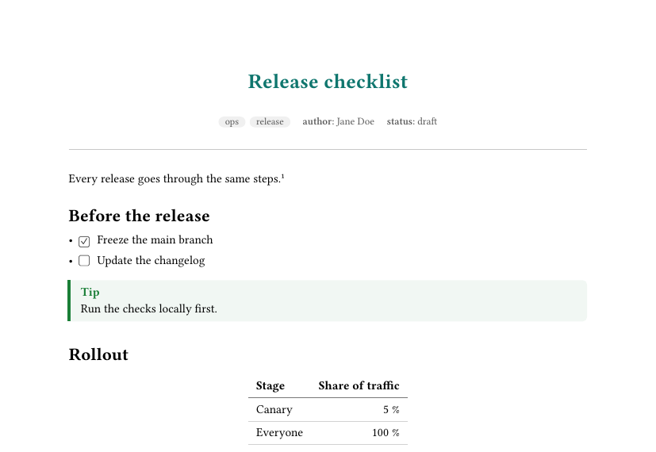
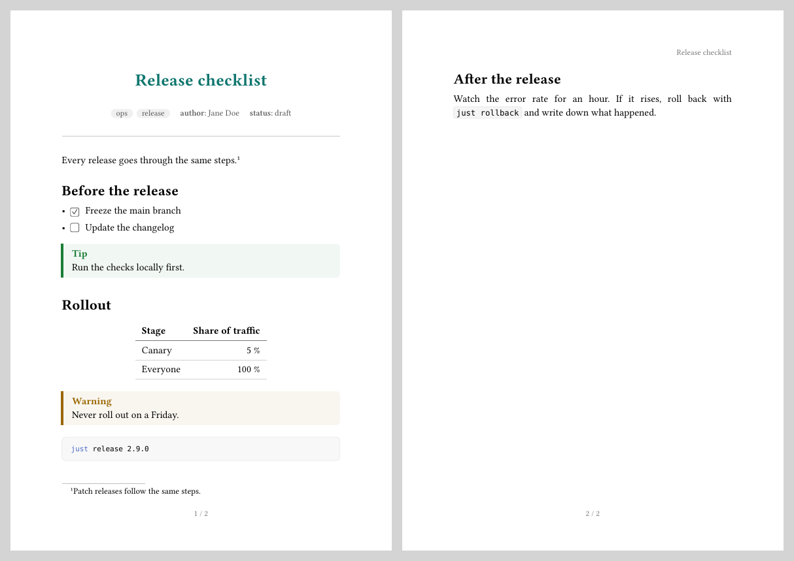
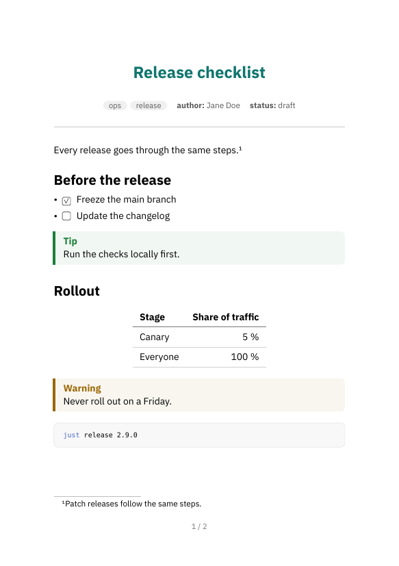
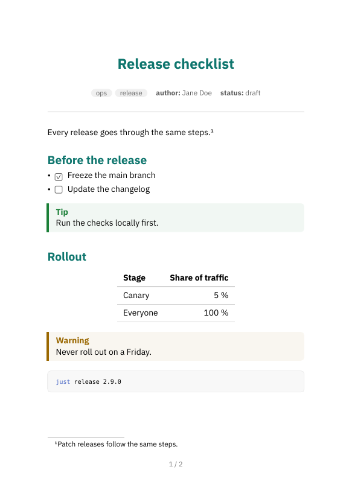
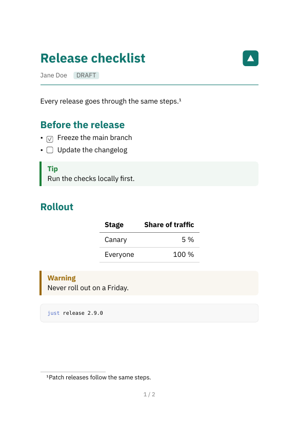
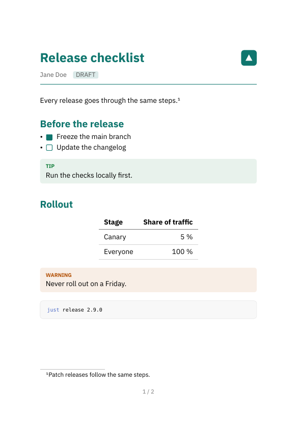
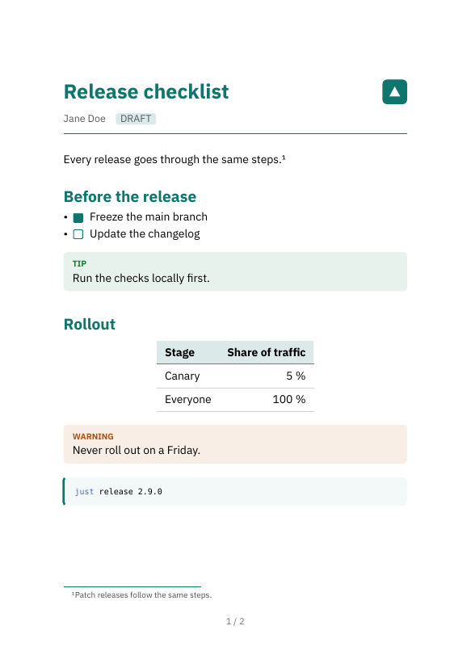

A document theme is one Typst file in your vault that decides how
`ntropy render` lays out a PDF: the page, the fonts, the title, the
callouts. This guide builds one called `handout`, starting from a copy of
ntropy's own look and changing one thing you can see per step.
[Document themes](01M28Q32HRVNF9EBZTC69XDZ49-document-themes.md) is the
reference behind it. The look of `render --to html` and of an exported
website comes from a [site theme](01M28Q32K56T4M52EGDDVYBSDX-site-themes.md)
instead.

You need [typst](https://typst.app) on your `PATH`, which every PDF
render needs, and a vault.

## Before you start

Every command in this guide runs in the root of your vault:

```bash
cd "$(ntropy info -p)"
```

Create the note the guide renders. It holds a little of everything a theme
styles: frontmatter, headings, a task list, callouts, a table, code and a
footnote.

````bash
ntropy write "$(ntropy new --empty -p Release checklist)" <<'EOF'
---
title: Release checklist
tags: [ops, release]
author: Jane Doe
status: draft
---
Every release goes through the same steps.[^1]

## Before the release

- [x] Freeze the main branch
- [ ] Update the changelog

> [!TIP]
> Run the checks locally first.

## Rollout

| Stage | Share of traffic |
| :--- | ---: |
| Canary | 5 % |
| Everyone | 100 % |

> [!WARNING]
> Never roll out on a Friday.

```sh
just release 2.9.0
```

## After the release

Watch the error rate for an hour. If it rises, roll back with
`just rollback` and write down what happened.

[^1]: Patch releases follow the same steps.
EOF
````

This is the command that renders it, and the one each step below means by
"render again":

```bash
ntropy render --force -o /tmp/release-checklist.pdf 'title:"Release checklist"' && open /tmp/release-checklist.pdf
```

On Linux, use `xdg-open` in place of `open`. The `&&` opens the PDF only
when the render worked, so a failed render does not leave you looking at
the previous one.

## Step 1: Copy the default and switch it on

The whole layout of a PDF is one Typst function, `note`. Copy ntropy's own
into a theme file:

```bash
mkdir -p .ntropy/themes/typst
ntropy render --to typst --theme default --force -o /tmp/default.typ 'title:"Release checklist"'
sed -n '/^#let note(/,/^}/p' /tmp/default.typ > .ntropy/themes/typst/handout.typ
```

`--to typst` writes the Typst document ntropy hands to typst, and
`--theme default` makes it use the built-in look even if your vault has a
theme already. The `sed` line keeps the `note` function from it.

Switch the theme on by adding this table at the end of
`.ntropy/config.toml`:

```toml
[render]
theme = "handout"
```

Render again. The PDF looks the same as before, because the theme is still
a copy. Now make it yours: add a colour at the very top of `handout.typ`,

```typst
#let accent = rgb("#0f766e")
```

and find the line that draws the title further down. Give it that colour:

```typst
    align(center, text(size: 1.7em, weight: "bold", fill: accent, title))
```

Render again, and the title is teal.



ntropy places your theme after its own definitions, so your `note`
replaces the built-in one. Everything the theme does not define keeps the
built-in version; the callouts and checkboxes come from ntropy until
step 6.

> [!TIP]
> A small change needs no copy. A theme file holding only
> `#set text(font: "IBM Plex Sans")` changes the font and keeps the
> built-in layout. The copy is for changing the layout itself.

> [!TIP]
> `--theme default` renders one note in the built-in look, which is handy
> for a side-by-side comparison.

## Step 2: Page and paper

Replace the line that starts with `set page(` with this block:

```typst
  set page(
    paper: paper,
    margin: (x: 2cm, top: 2.5cm, bottom: 2.2cm),
    header: context if here().page() > 1 {
      set text(size: 0.8em, fill: luma(120))
      align(right, title)
    },
    footer: context {
      set text(size: 0.8em, fill: luma(120))
      align(center, counter(page).display("1 / 1", both: true))
    },
  )
```

Then pick a smaller paper size. Add `paper` to the table in
`.ntropy/config.toml`, which now reads:

```toml
[render]
theme = "handout"
paper = "a5"
```

Render again. The note now fills two A5 pages, each with its page number
at the bottom, and the second page carries the title in its header.



> [!NOTE]
> Keep `paper: paper`. It is how the `paper` setting of
> `.ntropy/config.toml` reaches the theme; with a fixed value there, the
> setting does nothing. The paper sizes are listed under
> [Document themes](01M28Q32HRVNF9EBZTC69XDZ49-document-themes.md#paper-size).

## Step 3: Fonts

The built-in look uses the fonts that come with typst. A theme can use any
font typst finds: the fonts installed on your system, and the fonts in the
directories `TYPST_FONT_PATHS` names. A font file in your vault is not
found on its own.

This guide uses IBM Plex Sans, which is free under the SIL Open Font
License. Download it and keep its files in the vault:

```bash
curl -L -o /tmp/ibm-plex-sans.zip 'https://github.com/IBM/plex/releases/download/%40ibm%2Fplex-sans%401.1.0/ibm-plex-sans.zip'
unzip -q /tmp/ibm-plex-sans.zip -d /tmp/plex
mkdir -p assets/fonts
cp /tmp/plex/ibm-plex-sans/fonts/complete/ttf/IBMPlexSans-{Regular,Italic,Bold,BoldItalic}.ttf assets/fonts/
export TYPST_FONT_PATHS="$(ntropy info -p)/assets/fonts"
```

The `export` holds for this terminal only. Run it again in a new one, or
put it in your shell's profile. Installing the font on your system instead
works too, and then nothing needs exporting.

Check that typst knows the font by the name you are about to use:

```bash
typst fonts --font-path assets/fonts
```

The list includes `IBM Plex Sans`. Now change the line
`set text(size: 11pt)` to:

```typst
  set text(font: "IBM Plex Sans", size: 10pt)
```

Render again, and the text is set in Plex.



> [!WARNING]
> A font name typst does not find is replaced by the default font without
> a word, also under `--strict`. If the PDF still shows the old font, the
> name is misspelt or `TYPST_FONT_PATHS` is not set in this terminal.
> `pdffonts /tmp/release-checklist.pdf` (from poppler, if you have it)
> lists the fonts in the PDF: yours should be there, and Libertinus Serif
> in its place means the name was not found. A glyph your font lacks is
> taken from another font, which then shows up in that list too.

## Step 4: Headings and text

Four edits in the rules near the top of `note`. Paragraphs stop being
justified and get more space between them:

```typst
  set par(justify: false, leading: 0.65em, spacing: 1.2em)
```

Headings get more air above them and the accent colour. Change the first
`show heading` line and add one below it:

```typst
  show heading: set block(above: 1.8em, below: 0.7em)
  show heading: set text(fill: accent)
```

Make second-level headings a little smaller:

```typst
  show heading.where(level: 2): set text(size: 1.15em)
```

And links take the accent colour too:

```typst
  show link: set text(fill: accent)
```

Render again.



> [!TIP]
> `set heading(numbering: "1.1")` numbers headings by their Markdown
> level. Most notes start their sections at `##`, and those come out as
> `0.1`, `0.2`. A numbering function that skips the first level avoids
> that: `set heading(numbering: (..n) => numbering("1.1", ..n.pos().slice(1)))`.

## Step 5: Title and frontmatter

The title block is where a theme decides what of the frontmatter reaches
the page. `handout` shows the author and the status, leaves the tags out,
and puts a logo beside the title. Create the logo first:

```bash
mkdir -p assets
cat > assets/logo.svg <<'EOF'
<svg xmlns="http://www.w3.org/2000/svg" width="32" height="32" viewBox="0 0 32 32">
  <rect width="32" height="32" rx="6" fill="#0f766e"/>
  <path d="M9 22 L16 9 L23 22 Z" fill="#ffffff"/>
</svg>
EOF
```

In `handout.typ`, delete everything from the line `if title != none {`
down to the line `v(0.9em)`, both included. The title and the metadata
strip of the built-in look are gone; `body` and the closing `}` stay at the
end. Put this in their place:

```typst
  grid(
    columns: (1fr, auto),
    align: horizon,
    text(size: 1.8em, weight: "bold", fill: accent, title),
    image("/assets/logo.svg", height: 2.2em),
  )

  let author = frontmatter.at("author", default: none)
  let status = frontmatter.at("status", default: none)
  block(above: 0.8em, below: 0.8em, {
    set text(size: 0.9em, fill: luma(90))
    if author != none { fmt-value(author) }
    if status != none {
      h(1em)
      box(
        fill: accent.lighten(85%),
        radius: 2pt,
        inset: (x: 4pt, y: 2pt),
        upper(fmt-value(status)),
      )
    }
  })
  line(length: 100%, stroke: 0.8pt + accent)
  v(0.8em)
```

Render again.



`note` receives four things. `title` is the note's title. `frontmatter`
is the note's whole frontmatter as Typst values, `title` and `tags`
included, so `frontmatter.at("author", default: none)` reads a field
without failing on a note that lacks it. `fmt-value` is a helper of
ntropy's that turns any frontmatter value, a list included, into text.
`paper` is the paper size from step 2, and `body` is the note itself.
[Document themes](01M28Q32HRVNF9EBZTC69XDZ49-document-themes.md#what-note-receives)
has the details.

> [!NOTE]
> A path that starts with `/` is read from the vault root, so
> `/assets/logo.svg` is the file you just created.

## Step 6: Callouts, checkboxes and note links

Three more functions decide how a callout, a task-list checkbox and a link
to another note look. Unlike the rules so far, they are not part of `note`:
add them at the end of `handout.typ`, after the `}` that closes `note`.

```typst
#let callout-colors = (
  note: accent,
  tip: rgb("#15803d"),
  important: rgb("#7c3aed"),
  warning: rgb("#b45309"),
  caution: rgb("#b91c1c"),
)

#let callout(kind: "note", body) = {
  let color = callout-colors.at(kind)
  block(width: 100%, fill: color.lighten(90%), radius: 3pt, inset: 0.8em, {
    text(size: 0.75em, weight: "bold", fill: color, upper(kind))
    linebreak()
    body
  })
}

#let task(done: false) = {
  box(
    width: 0.8em,
    height: 0.8em,
    radius: 1pt,
    baseline: 0.1em,
    stroke: 0.7pt + accent,
    fill: if done { accent } else { none },
  )
  h(0.4em)
}

#let notelink(body) = text(fill: accent)[#body #sym.arrow.r]
```

`callout` receives the kind in lower case, one of `note`, `tip`,
`important`, `warning` and `caution`. Render again: the callouts are tinted
boxes with a small label, and a done task has a filled box.



The sample note links to no other note. In one that does, the link now
shows the other note's title in the accent colour with an arrow after it,
where the built-in look sets it in blue italics.

## Step 7: Tables, code and footnotes

Everything else in a note, tables, code, quotes, lists and footnotes
among it, is a plain Typst element in `body`. `set` and `show` rules
inside `note` style it, the way the copied rules already do. Three edits:

In the `show raw.where(block: true)` rule, change the `fill` and `stroke`
lines, so code blocks get a tint and a bar on the left:

```typst
    fill: accent.lighten(95%),
    stroke: (left: 2pt + accent),
```

Below the line `show table.cell.where(y: 0): set text(weight: "bold")`,
tint the header row of tables:

```typst
  set table(fill: (x, y) => if y == 0 { accent.lighten(85%) })
```

Below the line `set line(stroke: 0.6pt + luma(190))`, style the footnotes:

```typst
  set footnote.entry(separator: line(length: 40%, stroke: 1pt + accent))
  show footnote.entry: set text(size: 0.85em, fill: luma(80))
```

Render again. That is the finished `handout`.



[Document themes](01M28Q32HRVNF9EBZTC69XDZ49-document-themes.md#what-the-body-is-made-of)
lists the element each Markdown construct becomes.

> [!NOTE]
> The rules for tables, code, quotes and links you edited here came with
> the copy from step 1. A `note` written from scratch has none of them, and
> its tables, code and quotes come out in typst's plain defaults.

## Check your theme

Render a few of your real notes with the theme, and one with
`--theme default` next to it.

ntropy does not show typst's warnings, such as the one for a font typst
does not find. To see them, write the Typst document and compile it
yourself:

```bash
ntropy render --to typst --force -o /tmp/check.typ 'title:"Release checklist"'
typst compile --root "$(ntropy info -p)" - /tmp/check.pdf < /tmp/check.typ
```

In a terminal without `TYPST_FONT_PATHS`, that prints:

```
warning: unknown font family: ibm plex sans
    ┌─ <stdin>:220:17
    │
220 │   set text(font: "IBM Plex Sans", size: 10pt)
    │                  ^^^^^^^^^^^^^^^
```

A theme that does not compile fails the render with typst's error. The
line it names after `<stdin>` is a line of that Typst document, not of
your theme file: open `/tmp/check.typ` at that line to see which of your
lines it is. An error in a file your theme imports names that file
instead, as
[Document themes](01M28Q32HRVNF9EBZTC69XDZ49-document-themes.md#errors-and-warnings)
describes.
