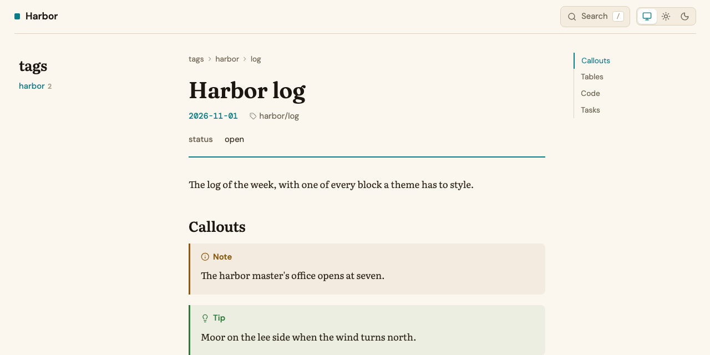
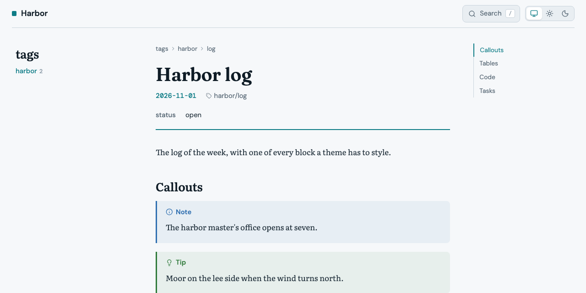
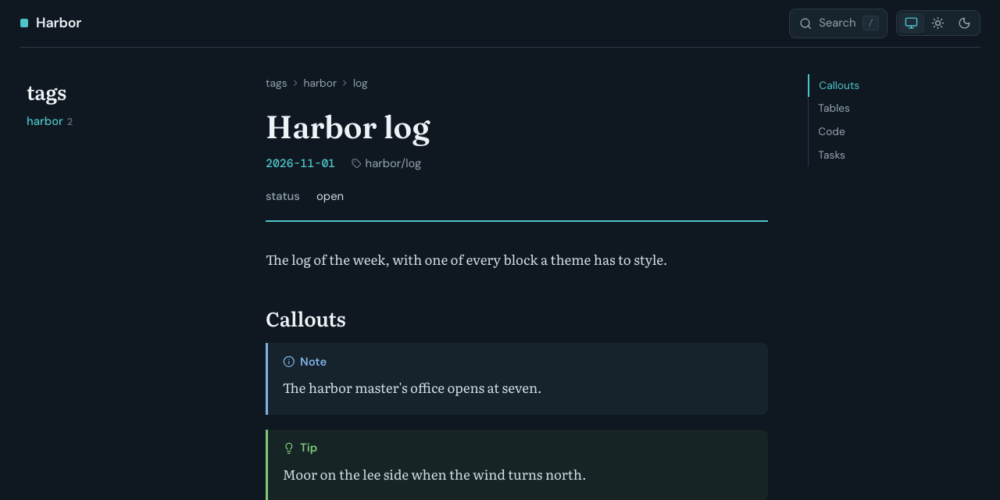
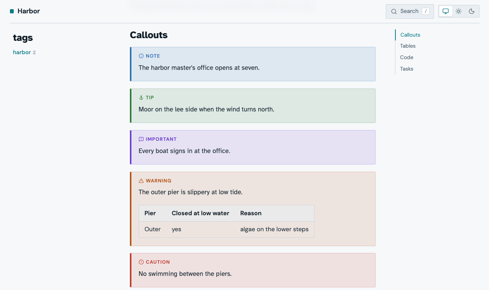
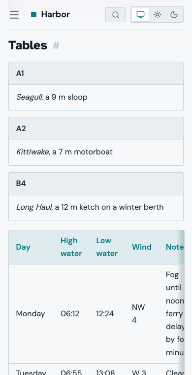
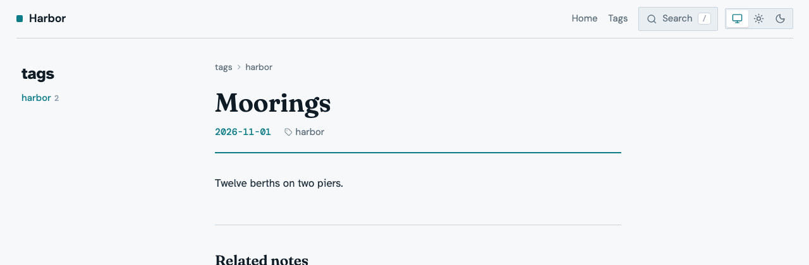

A site theme gives the pages of `ntropy site` and `ntropy render --to html`
your own look. This guide builds one theme, *harbor*, in seven steps:
colours, a font, corners, an icon, callouts, tables, and a header with a
footer. Each step changes one thing and says what you should see. You need
a vault with a few notes and a web browser. The reference behind it is
[Site themes](01M28Q32K56T4M52EGDDVYBSDX-site-themes.md), which lists every
property, class, block, and template variable the steps use, and many more.

## Before you start

Every command in this guide runs in the root of your vault:

```bash
cd "$(ntropy info -p)"
```

The steps work on any note.

## Quick start

First copy the built-in theme into the vault under the name `harbor`:

```bash
ntropy site theme init harbor
```

This writes `.ntropy/themes/site/harbor/` with the stylesheet `style.css`,
the fonts, the icons, and the page templates. Switch the vault to the theme
in `.ntropy/config.toml`, and add the `[site]` table if the file has none
yet:

```toml
[site]
theme = "harbor"
```

> [!NOTE]
> `--theme <name>` picks another theme for one export, and
> `--theme default` the built-in look. How a vault selects its themes is
> in [Themes](01M6CJK3JX0YS4R2FFHPJTG0JG-themes.md).

Export the site and open its front page:

```bash
open "$(ntropy site -o /tmp/harbor-site --force -p)"
```

On Linux, use `xdg-open` instead of `open`. The site looks exactly like the
built-in one, since the theme is still a copy of it.

Now open `.ntropy/themes/site/harbor/style.css`, find `--accent` in the first
`:root` block, and make it teal:

```css
  --accent: #0e7c86;
```

Export again with the same command and reload the page. Click the sun in the
header's switch for the light scheme: the square before the site name, the
date, the rule under the title, and the current entry of the outline are
teal now.



That is the whole loop: edit the theme, export, reload. Every step below
repeats it.

> [!IMPORTANT]
> Your theme's `style.css` is the whole stylesheet of the pages, and the
> fonts are the ones in its `fonts/`. A theme whose `style.css` you write
> from an empty file gets unstyled pages, so start from
> `site theme init`.

> [!WARNING]
> `--force` empties the output directory before writing. Point `-o` at a
> directory that holds nothing else, outside the vault.

## Step 1: Colours, light and dark

The built-in palette sits in three blocks near the top of `style.css`: the
light values on `:root`, and the dark values twice, both inside
`@media screen`. The first dark block applies when the system is set to
dark, unless the reader clicked the sun in the header's switch; the second
when the reader clicked the moon.

Instead of editing all three, add the harbor palette at the end of the
file. Of two rules with the same selector the later one wins, so these
override the values above them, and the rules that make your theme stay
together at the end of the file, ready to carry over to a fresh copy:

```css
/* Harbor: a cool, blue-grey palette with a teal accent. */

:root {
  --bg: #f6f8fa;
  --surface: #e9eef2;
  --raised: #ffffff;
  --border: #c9d3dc;
  --fg-bright: #0f1c26;
  --fg: #23323d;
  --muted: #5b6b78;
  --faint: #93a1ad;
  --accent: #0e7c86;
  --accent-soft: rgba(14, 124, 134, 0.1);
  --link: #0e7c86;
  --note-link: #0e7c86;
  --callout-note: #2f6fb0;
}

@media screen and (prefers-color-scheme: dark) {
  :root:not([data-theme="light"]) {
    --bg: #0f1820;
    --surface: #17232d;
    --raised: #1e2c38;
    --border: #2b3a47;
    --fg-bright: #eef3f7;
    --fg: #d3dde5;
    --muted: #95a5b2;
    --faint: #5f7080;
    --accent: #4fc3c9;
    --accent-soft: rgba(79, 195, 201, 0.12);
    --link: #6fd3d8;
    --note-link: #6fd3d8;
    --callout-note: #7fb2e5;
  }
}

@media screen {
  :root[data-theme="dark"] {
    --bg: #0f1820;
    --surface: #17232d;
    --raised: #1e2c38;
    --border: #2b3a47;
    --fg-bright: #eef3f7;
    --fg: #d3dde5;
    --muted: #95a5b2;
    --faint: #5f7080;
    --accent: #4fc3c9;
    --accent-soft: rgba(79, 195, 201, 0.12);
    --link: #6fd3d8;
    --note-link: #6fd3d8;
    --callout-note: #7fb2e5;
  }
}
```

Export and reload. With the sun picked, the page is a cool grey with teal
links:



Click the moon, and the page turns blue-black with a bright teal accent:



> [!NOTE]
> A property you leave out of the dark blocks keeps its built-in dark value,
> not your light one. List the same properties in all three blocks, and
> give both dark blocks the same values. Code keeps its token colours, which
> come from the highlighter, not from the palette.

> [!TIP]
> Keep the dark blocks inside `@media screen`, as the built-in ones are. A
> page then prints in the light palette whatever the scheme on screen.

## Step 2: A reading face

The note bodies are set in the `--serif` stack, Literata in the built-in
theme. Harbor uses Atkinson Hyperlegible instead, which is under the SIL
Open Font License like the built-in faces. Download its regular, italic,
and bold files and its license into the theme's `fonts/`, and delete
Literata, which harbor no longer uses:

```bash
fonts=.ntropy/themes/site/harbor/fonts
base=https://cdn.jsdelivr.net/fontsource/fonts/atkinson-hyperlegible@5.3.0
curl -L -o "$fonts/atkinson-hyperlegible-400.woff2" "$base/latin-400-normal.woff2"
curl -L -o "$fonts/atkinson-hyperlegible-400-italic.woff2" "$base/latin-400-italic.woff2"
curl -L -o "$fonts/atkinson-hyperlegible-700.woff2" "$base/latin-700-normal.woff2"
curl -L -o "$fonts/OFL-atkinson-hyperlegible.txt" \
  https://cdn.jsdelivr.net/npm/@fontsource/atkinson-hyperlegible@5.3.0/LICENSE
rm "$fonts"/literata-*.woff2
```

Delete the two `@font-face` rules for Literata at the top of `style.css`,
then declare the new face at the end of it and put it first in the stack:

```css
@font-face {
  font-family: "Atkinson Hyperlegible";
  font-style: normal;
  font-weight: 400;
  font-display: swap;
  src: url(fonts/atkinson-hyperlegible-400.woff2) format("woff2");
}

@font-face {
  font-family: "Atkinson Hyperlegible";
  font-style: italic;
  font-weight: 400;
  font-display: swap;
  src: url(fonts/atkinson-hyperlegible-400-italic.woff2) format("woff2");
}

@font-face {
  font-family: "Atkinson Hyperlegible";
  font-style: normal;
  font-weight: 700;
  font-display: swap;
  src: url(fonts/atkinson-hyperlegible-700.woff2) format("woff2");
}

:root {
  --serif: "Atkinson Hyperlegible", system-ui, sans-serif;
}
```

A `url()` is relative to `style.css`. Export and reload: the note text and
the note's headings are in Atkinson Hyperlegible, bold for the headings and
italic for emphasis and links to other notes. Bold italic has no file of
its own, so the browser makes it up. Page titles keep Fraunces, the chrome DM Sans,
and code DM Mono, the `--display`, `--sans`, and `--mono` stacks.

> [!TIP]
> Every file in `fonts/` is copied into the site's `assets/` and beside
> every `render --to html` page, whether the stylesheet uses it or not, so
> deleting the faces you dropped keeps both small. `fonts/LICENSE` stays: it
> covers the built-in faces harbor still uses.

## Step 3: Corners and the accent bar

The sizes are custom properties too, named for their job. Harbor squares
the corners and thickens the bar on the left of code blocks, quotes, and
callouts:

```css
:root {
  --radius-control: 2px;
  --radius-block: 2px;
  --radius-panel: 4px;
  --accent-bar: 4px;
}
```

Export and reload: callouts, code blocks, and the search button have sharp
corners, and the bar on the callouts is a pixel wider.

> [!NOTE]
> `--measure` sets the width of the reading column, 42rem in the built-in
> theme. On a site page the sidebar and the outline take their space first,
> so at 1280 pixels the column is narrower than 42rem already, and a wider
> `--measure` only shows in a wider window: 46rem shows from about 1440
> pixels. A `render --to html` page has no sidebar and shows 46rem at 1280.

## Step 4: An icon of your own

Every icon is one SVG file in `icons/`, named for its job. A tip callout
shows `lightbulb`. Replace `icons/lightbulb.svg` with an anchor:

```xml
<svg xmlns="http://www.w3.org/2000/svg" viewBox="0 0 24 24" fill="none" stroke="currentColor" stroke-width="2" stroke-linecap="round" stroke-linejoin="round">
  <circle cx="12" cy="5" r="2"/>
  <path d="M12 7v14"/>
  <path d="M8 11h8"/>
  <path d="M4 14a8 7 0 0 0 16 0"/>
</svg>
```

`stroke="currentColor"` makes the icon take the colour of the text around
it, as the built-in icons do. Export and reload: tip callouts carry the
anchor, as the next step's picture shows. The names the pages use are under
[Icons](01M28Q32K56T4M52EGDDVYBSDX-site-themes.md#icons).

## Step 5: Callouts

A callout is a `div` with the classes `callout` and `callout-<kind>` around
a `p.callout-title` and the text. Each kind sets the property `--callout`
to its colour. Harbor gives callouts a stronger tint, a frame, and a small,
spaced-out title:

```css
.callout {
  background: color-mix(in srgb, var(--callout) 12%, var(--bg));
  border: 1px solid color-mix(in srgb, var(--callout) 35%, var(--bg));
  border-left: var(--accent-bar) solid var(--callout);
  border-radius: var(--radius-block);
}

.callout-title {
  font-size: 0.75rem;
  letter-spacing: 0.08em;
  text-transform: uppercase;
}

.callout,
blockquote .callout {
  --table-cover: color-mix(in srgb, var(--callout) 12%, var(--bg));
}
```

The last rule matters once a table sits in a callout. A table wider than its
column scrolls, and the shadow at its edges is covered by a gradient in the
colour of the ground under the table, `--table-cover`. A callout with a new
tint needs that colour as its cover, or the edges show light bands. The
built-in stylesheet sets the cover for a callout inside a quote with the
more specific `blockquote .callout`, and a rule you add later only wins over
rules as specific as itself or less, so harbor names both.

Export and reload:



## Step 6: Tables

Every table sits in a `div.table-wrap`, and the frame, the rounded corners,
and the scrolling belong to that wrapper. Harbor tints the header row:

```css
th {
  background: var(--accent-soft);
  color: var(--accent);
}
```

Export and reload: header cells are teal on a light teal ground.

> [!NOTE]
> Open the browser's developer tools and turn on the device toolbar at 390
> pixels, or narrow the window: a table of two columns turns into a stack
> of cards, one per row, the first cell a tinted strip over the second.
> The built-in stylesheet does this once the note column is narrower than
> 32rem.



> [!WARNING]
> The card view needs `.layout > main` to be a container
> (`container-type: inline-size`). Keep that rule if you rework the
> layout, or the cards never appear. Put borders and corners on
> `.table-wrap`, not on `table`.

## Step 7: Header links and a footer

The pages are rendered from templates. `site theme init` copied the
built-in ones into `templates/`, and a file there replaces the built-in
template of the same name. The built-in ones are also available as
`ntropy/<name>`, so a template of yours can extend one and fill only its
empty blocks.

Replace the whole content of `templates/page.html` with:

```html

<nav class="site-links">
<a href="{{ prefix }}{{ link.href }}">{{ link.label }}</a>
</nav>
<footer class="site-footer">{{ vars.copyright }}</footer>
```

and put the links and the footer line into `.ntropy/config.toml`:

```toml
[site.vars]
copyright = "Harbor office, 2026"
links = [
  { label = "Home", href = "index.html" },
  { label = "Tags", href = "tags/index.html" },
]
```

`vars` is the `[site.vars]` table. Pages sit at different depths, and
`prefix` is the `../` that leads from a page back to the site's root; an
external URL takes no prefix. A note's page is `notes/<slug>.html` and a
tag's `tags/<tag>/index.html`, so after an export the output directory shows
the path of any page you want to link. `kind != "document"` leaves the
links out of a `render --to html` page, which has no site to link into.

The links need a few lines of CSS at the end of `style.css`:

```css
.site-links {
  display: flex;
  gap: 1rem;
  font-size: 0.875rem;
}

.site-links a {
  color: var(--muted);
  text-decoration: none;
}

.site-links a:hover {
  color: var(--link);
}

.site-footer {
  border-top: 1px solid var(--border);
  color: var(--muted);
  font-family: var(--sans);
  font-size: 0.8125rem;
  padding: 1.5rem var(--gutter);
  text-align: center;
}

@media (max-width: 40rem) {
  .site-links {
    display: none;
  }
}
```

Export and reload: the header holds Home and Tags beside the search, and
every page ends with the footer.



> [!NOTE]
> On a phone the header row has room for the menu button, the site name,
> the search, and the switch, and nothing more. With the links in it, the
> site name shrinks to nothing, which is why the last rule hides the links
> below 40rem.

> [!TIP]
> A template you delete from `templates/` falls back to the built-in one.
> Harbor changes only `page.html`, so you can delete `base.html` and
> `note.html`; the pages stay the same. To see what a page hands its
> template, put `<pre>{{ debug() }}</pre>` into the `before_content`
> block, export, look, and take it out again.

> [!WARNING]
> A template that fails stops the export, naming the template and the line.
> On a tag page or the generated front page `note` is none, so
> `{{ note.frontmatter.tagline }}` fails there: test it with
> `` first. Filling the `head` block replaces the stylesheet
> and the scripts unless it starts with `{{ super() }}`.

## Check your theme

Put the theme test note into your vault: a note that holds the parts of
a note body a theme styles, with the note it links to and the two images
it shows. [Themes](01M6CJK3JX0YS4R2FFHPJTG0JG-themes.md) describes the
test material and which releases carry it.

```bash
curl -fsSL https://ntropy.westhoffswelt.de/downloads/theme-test-note.tar.gz | tar xz -C "$(ntropy info -p)"
```

> [!NOTE]
> In an encrypted vault, run `ntropy reconcile` after the download. It
> encrypts the two notes the archive adds.

Export with `--strict`, which turns every warning into a failed exit
code, and render the theme test note as a page of its own:

```bash
ntropy site -o /tmp/harbor-site --force --strict
ntropy render --to html -o /tmp/harbor-note.html --force 'title:"Theme test note"'
```

The rendered page needs the `harbor-note_files/` directory beside it.
Then go through the theme test note, in the site and as the rendered
page:

- **Phone and desktop.** Turn on the device toolbar at 390 pixels, then
  look at a full window. The page must not scroll sideways. A code block
  or a wide table scrolls inside its own box; that is expected. The
  sidebar sits behind the menu button, and the outline comes after the
  note.
- **Light and dark.** Click the sun and the moon in the header's switch.
  Text, links, callouts, and code read well in both.
- **Print.** Open the print preview with the moon picked. The page prints
  in the light palette, the `#` after the headings is gone, and wide
  tables print whole.
- **The rendered page.** Open `/tmp/harbor-note.html`. It has no sidebar
  or search, and on a phone it is one column.
- **The built-in look.** Export the same notes with
  `ntropy site -o /tmp/builtin-site --force --theme default` and
  compare.

Your own vault may not have every kind of page. The theme test vault
does: a front page, a group page with its listing, a sidebar with a view
and tags, a breadcrumb of three steps, a hidden note, a note made of
words too long for a phone, and the theme test note. Download it, copy
your theme into it, and export it with the theme:

```bash
curl -fsSL https://ntropy.westhoffswelt.de/downloads/theme-test-vault.tar.gz | tar xz -C /tmp
mkdir -p /tmp/theme-test/.ntropy/themes/site
cp -R .ntropy/themes/site/harbor /tmp/theme-test/.ntropy/themes/site/
open "$(ntropy --vault /tmp/theme-test site -o /tmp/theme-test-site --force --theme harbor -p)"
```

Its front page, Welcome, lists what each page shows and what the vault
cannot show.

When you are done with the test note in your own vault, remove it again:

```bash
ntropy delete -n -f 01M6CCEVBP701HH0VPBT6ZNAYZ
ntropy delete -n -f 01M6CCEVCDRQ5504MDH503KQT2
rm -r assets/theme-test
```

[Making a front page](01M6CBSVZBM74V17MGTHGWYECR-making-a-front-page.md)
continues with the same theme.
