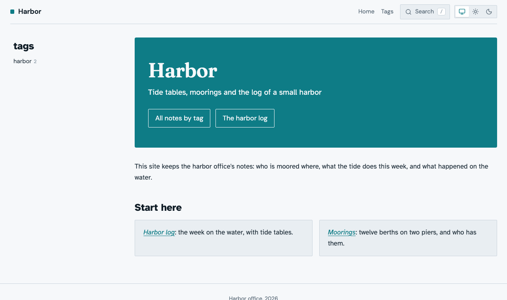
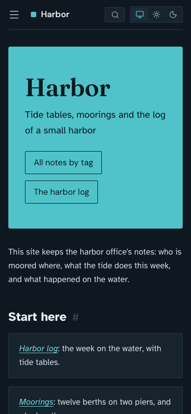

Without a front page of its own, a site opens on a generated overview: the
newest notes, the top-level tags, and the views. This guide turns one note
into the front page instead, with a banner, a short introduction, and links
into the site, and keeps it an ordinary note you edit like any other. It
continues the *harbor* theme of
[Writing a site theme](01M6CBSVXZXEW713FS476VB76F-writing-a-site-theme.md), so do that first or use a theme of your
own made with `ntropy site theme init`.

## Step 1: The front page note

Write the note that becomes the front page. Its body is the introduction,
in ordinary Markdown. `ntropy new --empty -p` creates an empty note and
prints its path, and `ntropy write` puts the whole note into it,
frontmatter first:

```bash
note=$(ntropy new --empty -p "Welcome")
ntropy write "$note" <<'NOTE'
---
title: Welcome
tags: [harbor]
---
This site keeps the harbor office's notes: who is moored where, what the
tide does this week, and what happened on the water.
NOTE
```

Name the note in `.ntropy/config.toml` by its id, the 26 characters before
the first `-` of its file name, which `ntropy search -n title:Welcome` also shows
in its ID column:

```toml
[site]
theme = "harbor"
title = "Harbor"
index = "01M6CBRQM0Z3ZPK7BGZKWZ29QN"
```

Export and open the site as in the theme guide: the front page is the
Welcome note, with its title, date, and tags, the breadcrumbs above it,
and the related notes below. `title` is the site's name in the header.

## Step 2: A banner from the frontmatter

The note picks a template of its own with `template` in the `site` table of
its frontmatter, and the template can read any other field of it. Add both
to the note's frontmatter, which `ntropy search <id>` opens in your
editor:

```yaml
---
title: Welcome
tags: [harbor]
tagline: Tide tables, moorings and the log of a small harbor
site:
  template: front
---
```

Create `templates/front.html` in the theme:

```html

{{ super() }} front
<section class="hero">
<h1 class="hero-title">{{ site_title }}</h1>
<p class="hero-tagline">{{ note.frontmatter.tagline }}</p>
</section>

```

It extends your theme's `page.html`, so the header links and the footer of
the theme guide come along, and fills its `before_content` block with the
banner. `{{ super() }} front` adds the class `front` to `body` and keeps the
`site` or `document` the stylesheet's layout depends on. The banner shows
the site's title, so the note's own header goes. Add the CSS at the end of
`style.css`:

```css
.front .note-header {
  display: none;
}

.hero {
  background: var(--accent);
  border-radius: var(--radius-panel);
  color: var(--bg);
  margin-bottom: var(--section-gap);
  padding: 3rem 2rem;
}

.hero-title {
  color: inherit;
  font-family: var(--display);
  font-size: 3rem;
  margin: 0;
}

.hero-tagline {
  font-size: 1.15rem;
  margin: 0.5rem 0 1.5rem;
}
```

Export and reload: the front page opens with a teal banner holding the
site's name and the tagline, and the introduction follows.

## Step 3: Links into the site

A front page sends the reader on. Harbor does it twice: buttons in the
banner, to pages of the site, and cards below the introduction, to notes.
The buttons come from a list in the frontmatter:

```yaml
---
title: Welcome
tags: [harbor]
tagline: Tide tables, moorings and the log of a small harbor
actions:
  - { label: All notes by tag, href: tags/index.html }
  - { label: The harbor log, href: tags/harbor/log/index.html }
site:
  template: front
---
```

A button's `href` is a path in the site: a tag's page is
`tags/<tag>/index.html`, a note's page `notes/<slug>.html`, and after an
export the output directory shows the path of any page. Replace
`templates/front.html` with the version that draws them:

```html

{{ super() }} front
<section class="hero">
<h1 class="hero-title">{{ site_title }}</h1>
<p class="hero-tagline">{{ note.frontmatter.tagline }}</p>
<p class="hero-actions">
<a href="{{ prefix }}{{ action.href }}">{{ action.label }}</a>
</p>
</section>

```

`prefix` reaches the site's root from the page, and `kind != "document"`
leaves the buttons out of a `render --to html` page of the note, which has
no site around it. The cards are a list of note links at the end of the
note's body; pick two notes from `ntropy search -n` and link them by file
name:

```markdown
## Start here

- [Harbor log](01M6CBNRGEPMEQ70EV0XR1KNBC-harbor-log.md): the week on the water, with tide tables.
- [Moorings](01M6CBNRJ39E2MPBRHBBCNT1M7-moorings.md): twelve berths on two piers, and who has them.
```

Then the CSS for both:

```css
.hero-actions {
  display: flex;
  flex-wrap: wrap;
  gap: 0.75rem;
  margin: 0;
}

.hero-actions a {
  border: 1px solid currentColor;
  border-radius: var(--radius-control);
  color: inherit;
  font-family: var(--sans);
  padding: 0.5rem 1rem;
  text-decoration: none;
}

.hero-actions a:hover {
  background: var(--bg);
  color: var(--accent);
}

.front .note-body > ul {
  display: grid;
  gap: 1rem;
  grid-template-columns: repeat(auto-fit, minmax(14rem, 1fr));
  list-style: none;
  padding: 0;
}

.front .note-body > ul > li {
  background: var(--surface);
  border: 1px solid var(--border);
  border-radius: var(--radius-block);
  padding: 1rem 1.25rem;
}
```

Export and reload: two buttons in the banner, and the two notes as cards
side by side, one above the other on a narrow screen.

> [!NOTE]
> `ntropy reconcile` keeps the cards' links pointing at their notes when a
> title changes, and a link to a note the export leaves out is a warning.
> A link to a note that no longer exists becomes plain text without one,
> and the buttons' paths are never checked: click every button and card
> after an export.

## Step 4: Room for the page

The front page needs no breadcrumbs and no outline, and its banner wants
the width the outline took. This CSS hides both and lets the content take
the rest of the row on a wide screen:

```css
.site.front .breadcrumbs,
.site.front .side {
  display: none;
}

.site.front .layout > main {
  max-width: none;
}

@media (width > 60rem) {
  .site.front .layout {
    grid-template-columns: var(--sidebar-width) minmax(0, 1fr);
    grid-template-areas:
      "header header"
      "sidebar main";
  }
}
```

Export and reload: the banner and the cards reach the right edge of the
page, and on a phone the page is one column as before.

> [!WARNING]
> The two-column grid sits inside `@media (width > 60rem)` on purpose.
> `.site.front .layout` is more specific than the built-in rule that makes
> the page one column on a narrow screen, and outside the query it would
> win there too. `.site` keeps it off a `render --to html` page of the note,
> which keeps the built-in document layout.

## Step 5: Out of the navigation

The front page is reached through the site's name in the header, so the
note needs no entry in the sidebar, no place in the previous and next
links, and no related notes under it. Add to its `site` table:

```yaml
site:
  template: front
  hidden: true
  related: false
```

Export and reload: the front page ends with the cards and the footer, and
Welcome is gone from the sidebar, its counts, and the previous and next
links of the other pages.





The note stays a note. It keeps its own page, drawn with the same
template, at `notes/welcome.html`, or with a short tail after `welcome`
when another note's slug is `welcome` too. `ntropy search` finds it, and
you change the introduction, the tagline, or the cards by editing it.

> [!NOTE]
> The ntropy website goes the other way: its front page template holds all
> of the page's markup, an install switcher and a video among it, and the
> index note only selects that template. That suits markup Markdown cannot
> express, at the cost of writing the header and its scripts into the
> template yourself; [Site themes](01M28Q32K56T4M52EGDDVYBSDX-site-themes.md#what-the-page-scripts-need)
> lists what they need.

## Check the front page

Export with `--strict` and look at the front page at 390 pixels and in a
full window, with the sun and with the moon. A note that names a template
the theme does not have is a warning, and the page uses `page.html`, so
`--theme default` warns about the front page note: that warning is
expected.
