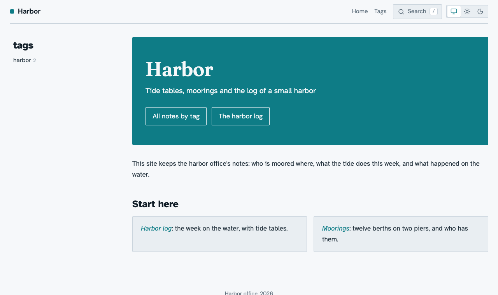
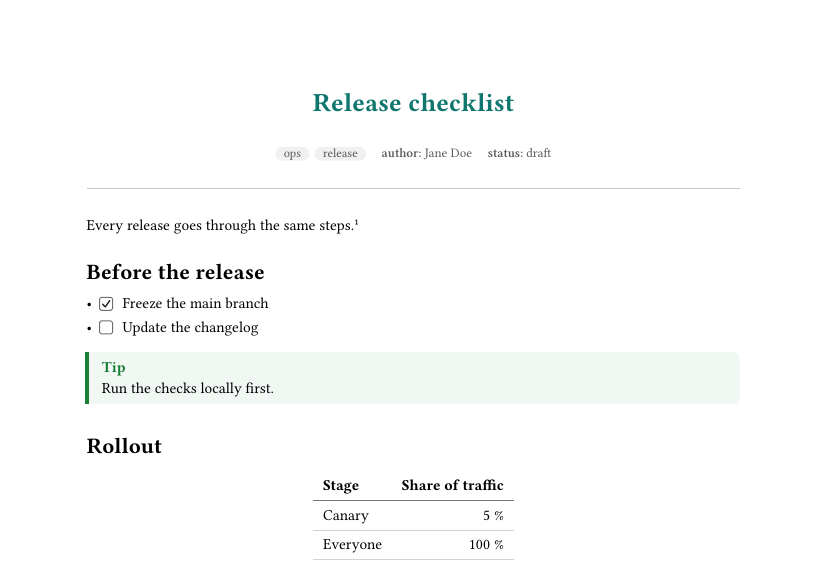
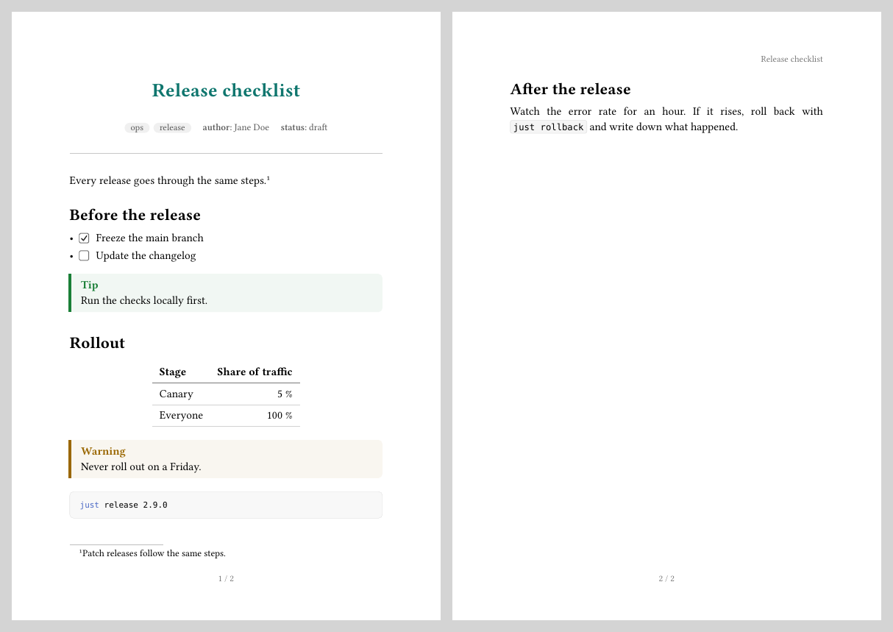

A note's images, PDFs, transcripts and any other file live in a folder of their own, named like the note. ntropy copies files in, keeps the folder's name and the links into it in step with the note, and removes the folder with the note. This page covers the layout, the two commands, what the other commands do with the folder, and how to move an existing structure into it by hand.

## Where a note's files live

A note's folder is `all-notes/_assets/<note file name without extension>/`. For the note `01M6CBSVZBM74V17MGTHGWYECR-making-a-front-page.md` it is:

```
all-notes/_assets/01M6CBSVZBM74V17MGTHGWYECR-making-a-front-page/
```

The note links its files with plain relative paths, which every Markdown viewer resolves without ntropy:

```markdown

```

A folder belongs to the note whose ULID starts its name, whatever slug follows. Each note has only its own files: a link into another note's folder is refused by renders and exports and reported by `reconcile`.

## Adding and listing files

`ntropy asset add` copies files into a note's folder and prints a Markdown link for each:

```bash
ntropy asset add 01M6CBSVZBM74V17MGTHGWYECR 07-front-page.png notes.pdf
```

```
added all-notes/_assets/01M6CBSVZBM74V17MGTHGWYECR-making-a-front-page/07-front-page.png
added all-notes/_assets/01M6CBSVZBM74V17MGTHGWYECR-making-a-front-page/notes.pdf

[notes.pdf](_assets/01M6CBSVZBM74V17MGTHGWYECR-making-a-front-page/notes.pdf)
```

The `added` lines go to stderr and the links to stdout, so a pipe or a command substitution takes only the links. An image extension (`png`, `jpg`, `jpeg`, `gif`, `webp`, `svg`, `avif`, `bmp`) gets an image link, any other file a plain link. `asset add` never edits the note: you place the link where you want it.

The note is a ULID, a file name or path, or a query that matches one note. Several matches open the picker on a terminal and are an error under `-n`. These options change what happens to the files:

- `--move` moves the files instead of copying them.
- `--as <name>` stores one file under another name.
- `--force` replaces a file of that name. Without it, a name that is already in the folder is an error and nothing is copied.

`ntropy asset list` shows what the folder holds:

```bash
ntropy asset list 01M6CBSVZBM74V17MGTHGWYECR
```

```
FILE                     SIZE      LINKED
07-front-page.png        36.5 KiB  yes
08-front-page-phone.png  32.5 KiB  yes
```

`LINKED` says whether the note links the file. A link into the note's own folder whose file is gone shows as `broken`. `--path` prints the folder's absolute path, also when it does not exist yet.

A `#` always starts the fragment of a link, so a file with a `#` in its name cannot be linked. `asset add` refuses such a name and suggests `--as`.

## Retitling a note

The folder's name follows the note's file name. After a retitle the folder keeps its old name until the next `reconcile`, which renames it and rewrites the links into it in every note:

```
renamed _assets/01M6CBSVZBM74V17MGTHGWYECR-making-a-front-page/ -> _assets/01M6CBSVZBM74V17MGTHGWYECR-building-a-front-page/
relinked _assets/01M6CBSVZBM74V17MGTHGWYECR-making-a-front-page/ -> _assets/01M6CBSVZBM74V17MGTHGWYECR-building-a-front-page/ in 01M6CBSVZBM74V17MGTHGWYECR-building-a-front-page.md (2 links)
```

The folder is found by the ULID in its name, so `asset add` between a retitle and the next `reconcile` still puts files into the right folder. A `reconcile` that was interrupted after the rename finishes the rewrite on its next run.

## Opening a note through a view

Every directory of a [materialized view](01M28Q32CXG2ANTFTF9H1AKNS8-materialized-views.md) holds an `_assets` symlink to `all-notes/_assets/`. A note opened from a view therefore finds its files at the same relative path as in `all-notes/`.

## Deleting a note

`ntropy delete` removes the note's folder with the note and says so in its confirmation, `Delete <note> and its 3 assets (1.3 MiB)? [y/N]`. The run then prints `Deleted 3 assets (1.3 MiB)` after the line for the note itself.

When another note links into the folder, the folder stays, `delete` names the notes that link it, and `--remove-assets` removes it anyway.

## What reconcile checks

`reconcile` warns about:

- a link to a file that is missing from the note's own folder,
- a link into another note's folder,
- a link to a file outside `all-notes/_assets/`, such as a file beside the notes or in a folder in the vault root. Such a file still renders and exports as it did,
- a folder in `_assets/` that no note owns, for example the folder of a deleted note, and a file directly in `_assets/`.

Nothing is deleted. Under `--strict` each of these fails the run. A folder name that is stale between a retitle and the next `reconcile` is not one of them.

## Files in a PDF

A PDF render attaches the files a note links in its own folder and shows a badge after each link. [Rendering to PDF and HTML](01M28Q32H5RYMZ5MHBQSQQN13B-rendering-to-pdf-and-html.md) has the details, including the size limit `attach_max`.

## Encrypted vaults

An encrypted vault takes no assets yet. `asset add` and `asset list` refuse to work in one, and `vault encrypt` refuses to start while `all-notes/_assets/` holds a file. [Encrypted vaults](01M28Q32DHD3RH94HNF80RQNGT-encrypted-vaults.md) explains why.

## Moving an existing structure by hand

ntropy ships no command that converts an old layout, because the layouts in use differ from vault to vault. The asset commands do the work once you know which files belong to which note. This is how this documentation vault moved its screenshots.

The three guides on writing themes kept their 15 screenshots in two folders at the vault root, `assets/document-theme/` and `assets/site-theme/`, and linked them as `../assets/document-theme/step-1.png`. A file outside `all-notes/_assets/` still renders, and `reconcile` warns about each link to one:

```bash
ntropy reconcile
```

```
warning: 01M6CAJG6C3WAZ2MD6W3EGBMKY-writing-a-document-theme.md: `../assets/document-theme/step-1.png` is outside `all-notes/_assets/`, so ntropy does not manage it
...
Scanned 30 notes, reassigned 0 notes, renamed 0 files, relinked 0 links, synced 0 views, ignored 0 entries, unignored 0 entries, 15 warnings.
```

The warnings name the files and the notes that link them. The first step is to move each note's files into its folder with `--move`:

```bash
ntropy asset add --move 01M6CAJG6C3WAZ2MD6W3EGBMKY assets/document-theme/step-*.png
```

```
added all-notes/_assets/01M6CAJG6C3WAZ2MD6W3EGBMKY-writing-a-document-theme/step-1.png
added all-notes/_assets/01M6CAJG6C3WAZ2MD6W3EGBMKY-writing-a-document-theme/step-2.png
...


...
```

The same command moves the other two notes' files. `asset add` does not touch the notes, so the second step is to point their links at the new place. Every old link of a note had the same prefix, so one search and replace per note does it: in the document theme guide, `../assets/document-theme/` becomes `_assets/01M6CAJG6C3WAZ2MD6W3EGBMKY-writing-a-document-theme/`. Where the old links share no prefix, the printed links are the new text: paste each in place of the old link. The last step is the check, which is `reconcile` again:

```
Scanned 30 notes, reassigned 0 notes, renamed 0 files, relinked 0 links, synced 0 views, ignored 0 entries, unignored 0 entries, 0 warnings.
```

The emptied `assets/` folders are no longer needed and can be removed.
